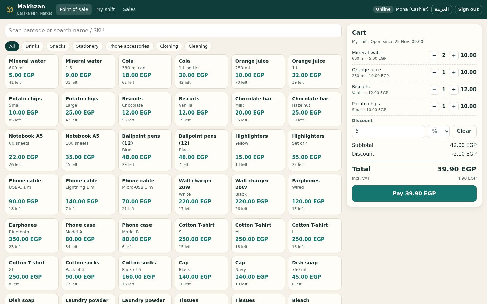
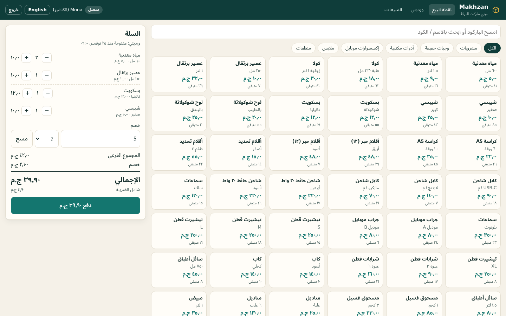
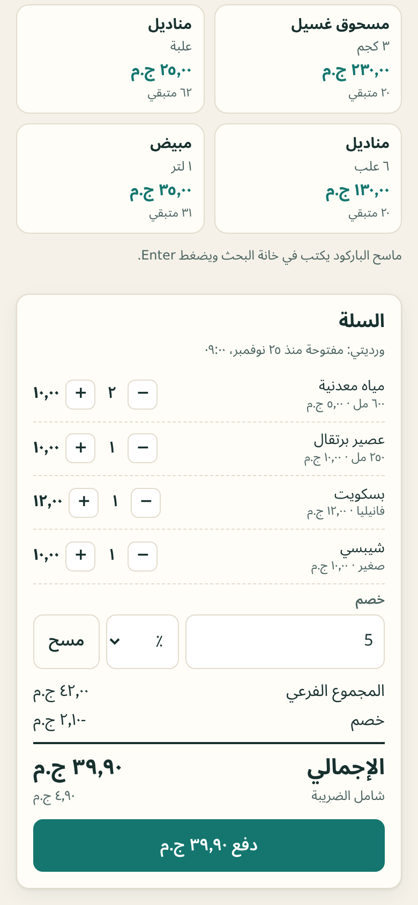
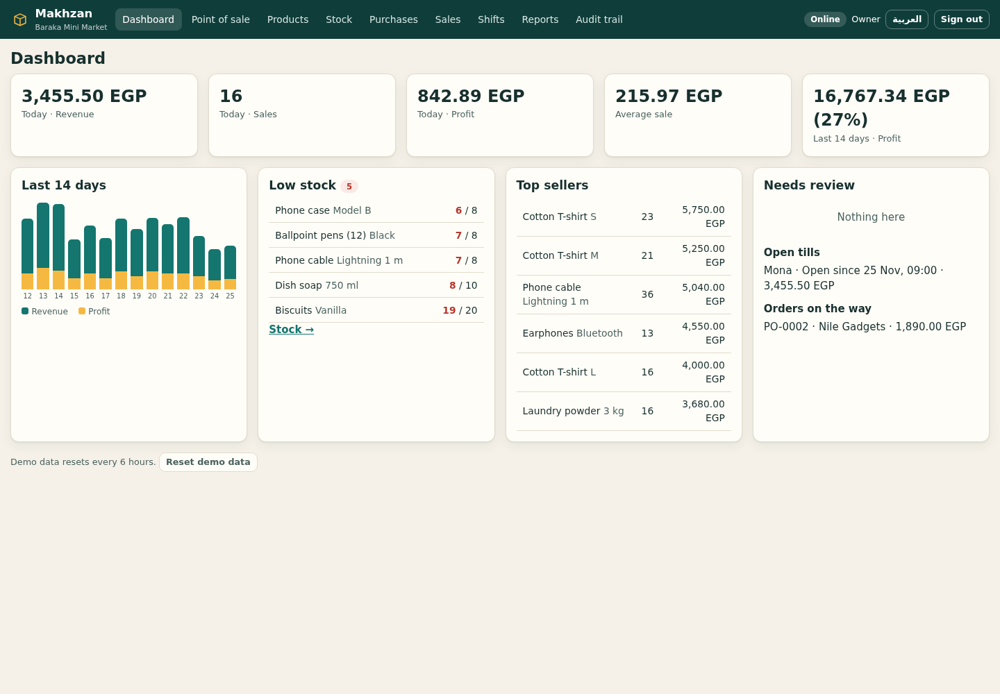
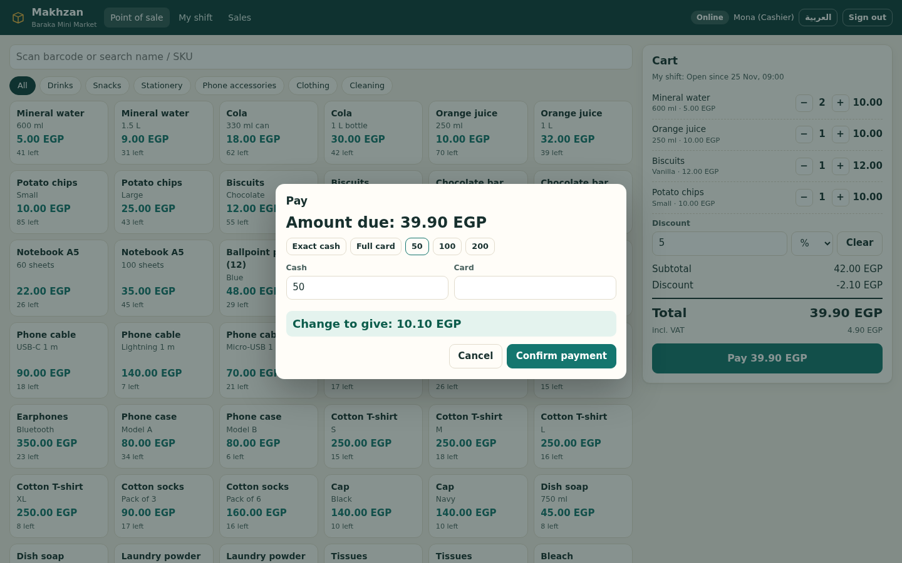
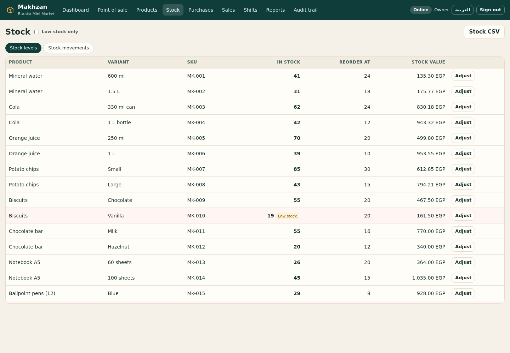
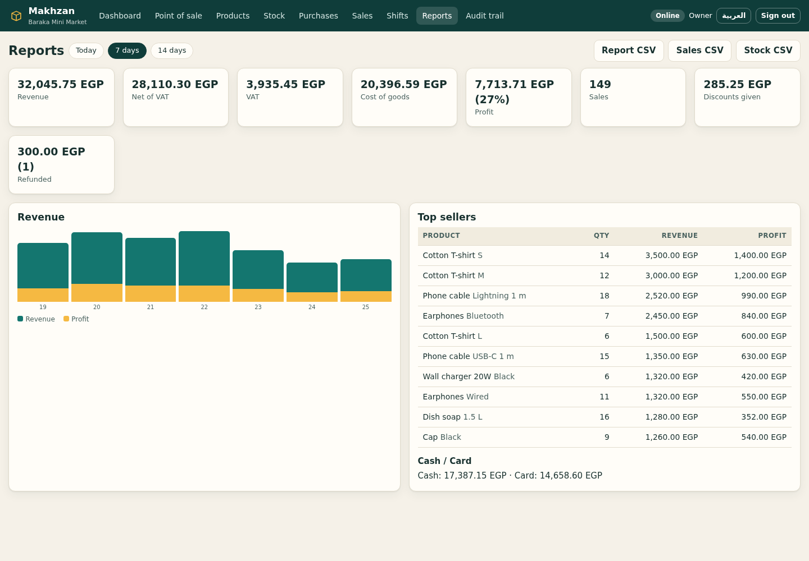
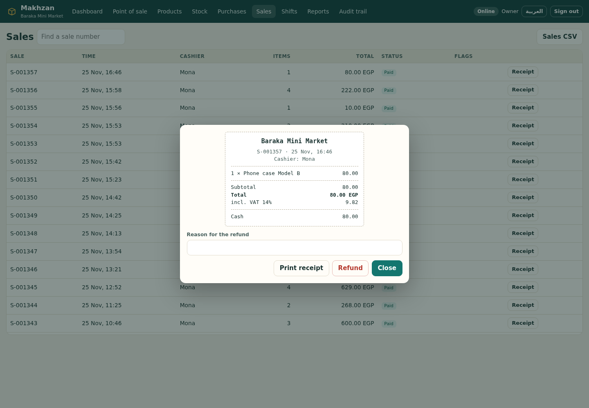

# Makhzan (مخزن): inventory and point of sale for small shops

A bilingual (English and Arabic, right to left) inventory and point-of-sale system for a small Egyptian shop. One cashier screen that keeps selling when the internet drops, and an owner back office for products, stock, purchases, shifts and reports.

**Live demo:** https://makhzan-pos-lovat.vercel.app  
Demo accounts (shown on the sign-in screen): Owner `1111`, cashier Mona `2222`, cashier Karim `3333`.  
The demo holds fake data for a made-up shop ("Baraka Mini Market") and resets every 6 hours. Everyone who opens it shares the same data.



| Arabic (RTL) point of sale | Phone layout |
|---|---|
|  |  |



| Payment: cash and card split, change | Stock with low-stock alerts |
|---|---|
|  |  |

| Reports | Receipt and refund |
|---|---|
|  |  |

## What it does

**Cashier (point of sale)**
- Scan a barcode or type a name or SKU in one box (a scanner types the code and presses Enter). Tap tiles by category. Products have variants (size, volume, colour), each with its own barcode, price and stock.
- Cart with quantity buttons. Discount as a percent or an amount. A cashier can give up to 10%, the owner any amount.
- Payment in cash, card, or both. Quick buttons for exact cash and common notes, live change, and the sale is refused if it is not fully paid or if change would have to come from a card.
- Receipt on screen with the VAT included, printable from the browser.
- Opens a shift with opening cash, and closes it with the counted cash. The difference to the expected cash is stored, and a note is required when it is not zero.
- Works offline (see below).

**Owner (back office)**
- Dashboard: today's revenue, sales, profit, average sale, 14-day chart, low stock, best sellers, open tills, orders on the way, and sales that need review.
- Products with variants, archive and restore. Unique SKU and barcode. Price changes keep the previous prices.
- Stock levels with reorder points and low-stock alerts, stock adjustments (count, damaged, expired, lost, found) that always need a reason, and a movement log. Every change to stock is written to the movement log and the audit trail with who did it.
- Suppliers and purchase orders. Receiving an order adds stock and moves the average cost.
- Sales list, receipts, full-sale refunds that put stock back.
- Shifts with expected cash, counted cash and the difference.
- Reports for today, 7 or 14 days: revenue, net of VAT, cost of goods, profit and margin, discounts, refunds, best sellers, cash and card totals. CSV export for sales, the daily report and stock.

**Roles.** The server decides, not the screen. A cashier cannot adjust stock, receive purchases, refund, edit products or see costs (the cashier view of the data has no cost fields at all).

## Offline

After a device has signed in once, the till opens with no connection (service worker for the app, a saved copy of the catalog on the device). Sales made offline are saved in a queue on the device with a unique id and sent when the connection returns. Each id is stored once, so a retry can never charge or deduct twice.

Rules the server applies to offline sales:
- The price the customer saw must be the current price or one of the last 5 prices. Anything else is refused and shown to the cashier with the reason, not dropped.
- Stock may go below zero offline. The sale is kept and flagged "sold below zero stock", and the item appears in low-stock alerts.
- If the shift was closed before the sale synced, the sale is kept but not added to that shift's cash, and flagged.
- The sale keeps the time it was made (accepted only for the last 7 days).

## Honest limits

This is a portfolio demo, not a finished product for a real shop.
- **Sign-in is demo-grade.** PINs are printed on the sign-in screen. Sessions are signed tokens that expire after 12 hours. A real shop needs real accounts, hashed passwords, lockout and audit of logins.
- **One shared workspace, no database.** State is one JSON file in Vercel Blob. Two saves at the exact same moment can overwrite each other. Fine for a demo, wrong for a busy shop. The next step would be Postgres with transactions.
- **Offline needs a first online sign-in** on that device. Opening or closing a shift, and all back-office work, need a connection. Prices are trusted offline only within the rule above.
- **Not tax-compliant.** VAT is a flat 14% included in the price. There is no Egyptian Tax Authority e-receipt or e-invoice integration and no per-item VAT classes.
- **No hardware drivers.** Card payments are recorded, not processed (no card terminal). Receipts print through the browser, not a thermal printer or a cash-drawer kick. Barcodes work with a keyboard-style scanner; there is no camera scanning.
- Refunds are for a whole sale only. No customers, loyalty, or partial returns.
- Server error messages are in English. Menus and labels are English and Arabic.

## Tests

```
npm install
npm test                                                  # 20 business-rule tests (money, discounts, payments, stock, shifts, refunds, roles, CSV, tokens, seed consistency)
npm run dev                                               # local server on http://localhost:3100 (state in memory)
node e2e/e2e.mjs http://localhost:3100                    # 41 browser checks (needs Chrome at /usr/bin/google-chrome)
node e2e/offline.mjs http://localhost:3100                # 17 offline checks: sell offline, reload offline, reconnect, exactly-once, refused sale shown
```
Both browser suites also run against the live URL. They end by resetting the demo data.

## Layout

```
public/logic.js    all business rules (pure, no I/O): used by the API, the app and the tests
public/app.js      the app (vanilla JS, no build step), i18n.js has English and Arabic text
public/sw.js       service worker for the app shell
api/data.js        one serverless function: sign-in, read, apply an operation
api/_auth.js       signed session tokens
test/              logic tests      e2e/  browser tests and screenshot script
```

## Deploy

Vercel project with a Blob store connected (it sets `BLOB_READ_WRITE_TOKEN`). `vercel deploy --prod`. No other settings.

Built with AI assistance (code generated by Instinct for Nada Gamal's portfolio). The business rules and tests are in this repo.
